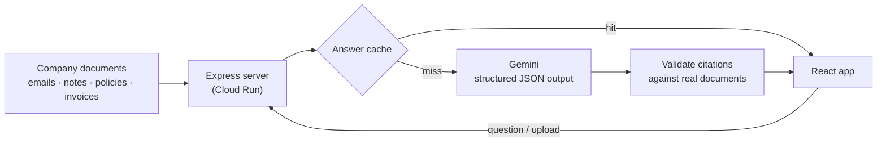

# Mnemo — the company memory that knows when your decisions go stale

> Companies don't lose knowledge. They lose the reasons, the rules and the people.

**Live demo:** https://mnemo-ry.ai.studio
**Built for:** Google Cloud AI Builder Cup 2026 · Future of Work & Enterprise Productivity
**Stack:** Gemini (Google Gen AI SDK) · Google Cloud Run · React + TypeScript · Express

---

## The problem

Every company runs on old decisions. "We use Vendor B", "Approvals take 3 days", "Ask Maria, she knows."
Over time three things quietly break:

1. **The reasons expire.** Vendor B was chosen because it was 20% cheaper. Two years later it costs more, and nobody notices.
2. **The rules contradict each other.** HR says approvals take 3 days, Finance says 5. Orders get stuck in the gap.
3. **The people leave.** When an expert resigns, their know-how walks out the door.

Search tools answer *what*. Nobody keeps track of *why*, or warns you when the *why* stops being true.

## What Mnemo does

Mnemo reads a company's emails, meeting notes, policies, quotes and invoices, and turns them into a structured decision memory:
**decision → reasons → assumptions → evidence**, with a source for every claim.

| Feature | What it does |
|---|---|
| **Ask Mnemo (Why)** | Ask "Why do we use Vendor B?" and get a cited timeline: who decided, when, which options were rejected and why. Proposing an idea that already failed triggers a **"Heads up: tried before"** warning. |
| **Assumption Expiry** (the core) | Every decision stores the assumptions it depends on. Upload a new document and Gemini checks it against every active assumption. When evidence contradicts one, the decision turns **Stale**, with the original reason and the new evidence side by side, a confidence level, and the monthly cost of keeping it. |
| **Conflicts** | Compares every policy and flags rules that contradict each other, shows the harm the conflict already caused, and drafts one merged rule for the owners to approve. |
| **Experts (Exit Twin)** | A departing expert's know-how, answerable in their voice, grounded **only** in their own records. If it isn't in the records, the twin says so instead of guessing. |

AI suggests, people decide: every alert shows its confidence and sources, and every fix is a draft for human approval.

## Try the demo (2 minutes)

The demo company is **Brightwell Logistics** (fictional). On the live site, follow the 5 steps on the Overview page:

1. **Ask** "Why do we use Vendor B?" → a cited 2024 decision timeline.
2. **Upload & Audit** → *Use sample invoice* → Vendor B is now $13.40/unit vs Vendor A's $12.80 quote. The decision turns **Stale**: **$4,800/month** overpaid.
3. **Decisions** → inspect the stale decision side by side.
4. **Conflicts** → *Scan for conflicts* → HR's 3-day vs Finance's 5-day approval rule, and the delayed orders it caused.
5. **Experts** → *Ask Maria's twin* what to do about Vendor B, then ask something she never covered.

**Reset Demo** (top right) returns everything to the starting state.

## How it uses Gemini



- **Four Gemini tasks**, each with its own prompt and response schema: decision timeline (Ask), assumption check (Expiry), policy contradiction scan (Conflicts), and grounded expert answers (Exit Twin).
- **Structured output:** every call uses `responseMimeType: application/json` with a `responseSchema` and temperature 0, so results are consistent and render directly into the UI.
- **Grounding rules:** prompts forbid facts that aren't in the documents; the server drops citations that point to documents that don't exist, and an expert answer without a valid citation is shown as "not in my records".
- **Model fallback:** requests try `gemini-3.5-flash-lite`, then `gemini-3.1-flash-lite`, then `gemini-3.8-flash`, so one busy or rate-limited model doesn't break the app.
- **Quota shield:** answers are cached on the server and shared by every visitor; a rate-limited model is paused instead of retried in a loop. If Gemini is unavailable, the demo questions fall back to verified answers from the records, clearly labelled **"Verified memory"**. Questions outside the records still return an honest error, never an invented answer.

## Run it locally

Requires Node.js 20+ and a Gemini API key from [Google AI Studio](https://aistudio.google.com).

```bash
npm install --legacy-peer-deps
cp .env.example .env          # then set GEMINI_API_KEY in .env
npm run dev                    # http://localhost:3000
```

Without a key the app still runs, using the verified demo answers.

## Project structure

```
server.ts                    Express API: Gemini calls, cache, model fallback
src/data/seedData.ts         Demo company: 11 source documents + 3 decisions
src/context/LoreContext.tsx  App state (decisions, documents, conflicts, chat)
src/components/
  AskLoreView.tsx            Ask Mnemo — cited decision timeline
  UploadView.tsx             Upload & Audit — Assumption Expiry
  DecisionsView.tsx          Decision cards and stale evidence
  ConflictsView.tsx          Policy contradiction radar
  ExpertsView.tsx            Maria's expert twin chat
```

## Roadmap

- **Connectors** for Gmail, Google Drive, Slack and Jira, so memory builds itself.
- **Firestore** for persistent, company-wide decision memory.
- **Document AI** for scanned invoices and contracts.
- **Vertex AI** deployment for enterprise data controls.
- **Scheduled watchers** that re-check every assumption when new data arrives, and notify the decision owner.

## Data

All company data in this demo is fictional. No real people, companies or personal data are used.
